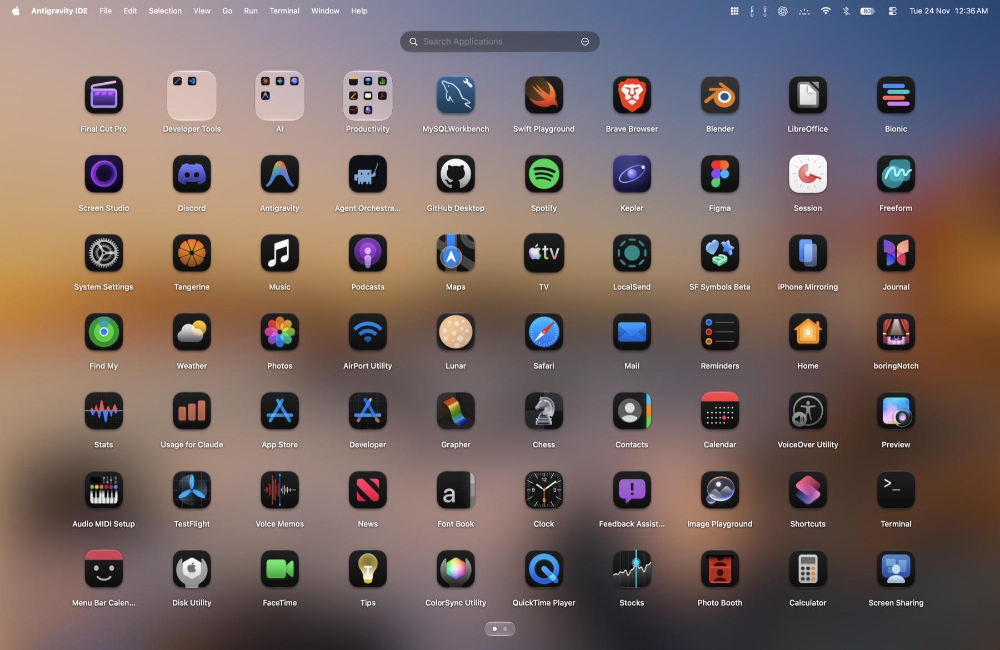

# Launchly

Launchly is a native macOS menu-bar application launcher built to replace the default macOS Launchpad. Open a full-screen glassy app grid by pinching four fingers inward on your trackpad (thumb + three fingers), and pinch outward to return straight to what you were working on.



## Features

- **Four-finger pinch in & out**: Opens on a 4-finger pinch-in and dismisses back to your previous app on a 4-finger pinch-out using `MultitouchSupport.framework` loaded dynamically at runtime, with adjustable **Pinch sensitivity** in Settings.
- **Apple Liquid Glass UI**: Uses native macOS 26+ Liquid Glass (`glassEffect`, `GlassEffectContainer`, `.buttonStyle(.glass)`) with `.ultraThinMaterial` fallbacks on macOS 14–15, keeps the macOS menu bar and Dock visible, and includes a **0%–100% Background opacity** slider from fully transparent to fully opaque.
- **Hardware-accelerated edge-to-edge swiping**: Smooth 120fps CoreAnimation paging (`CASpringAnimation` with trackpad flick velocity) that glides icons all the way to the physical edges of the screen with minimal battery and GPU usage.
- **Drag-to-reorder, app groups (folders), and cross-page movement**:
  - Drag any app onto another app to quickly form a folder, or onto an existing folder to add it.
  - Drag apps or folders to the left/right screen edges (or press `←`/`→` while dragging, or right-click → **Move to Page**) to move them across pages.
  - Click inside folders to launch, rename, reorder, or drag apps back out.
- **Flexible sorting**: Sort by **Custom**, **Name**, **Most Used**, **Date Added**, **Last Opened**, or **Size** (ascending or descending) directly from the `•••` menu in the search bar or Settings.
- **Instant Spotlight search & keyboard navigation**: Search starts focused at the top (`Search Applications`), indexes Mac apps across standard application directories, and supports arrow-key navigation, `Return` to launch, and `Esc` to close folders / clear search / dismiss.
- **Menu bar, global hotkey & URL triggers**: Lives cleanly in the menu bar (`LSUIElement`), supports `⌃⌥Space` toggle, Launch at Login, clicking empty space between icons to dismiss, and `launchly://show|hide|toggle`.

## Download & Install

1. Download the latest **`Launchly-1.0.0.dmg`** from [GitHub Releases](https://github.com/aryanfulari/Launchly/releases/latest) (Universal binary — works on both Apple Silicon and Intel Macs running macOS 14.0+).
2. Open the `.dmg` and drag **Launchly** into your **Applications** folder.
3. **First launch (macOS Gatekeeper)**: Because Launchly is open-source and ad-hoc signed (not notarized with a paid Apple Developer ID), macOS may warn that it cannot be verified or appears damaged on first launch. To allow it:
   - Run this once in Terminal:
     ```zsh
     xattr -cr /Applications/Launchly.app
     ```
   - Or open **System Settings › Privacy & Security**, scroll down, and click **Open Anyway**.
4. Open **Launchly** from Applications, then disable the conflicting system trackpad gestures (see [Trackpad Gesture Setup](#trackpad-gesture-setup) below) so four-finger pinch works smoothly.

## Requirements

- macOS 14.0+ (Apple Silicon or Intel)
- For building from source: Xcode 15+ (native Liquid Glass requires Xcode 26+ / macOS 26+ SDK), and [XcodeGen](https://github.com/yonaskolb/XcodeGen) (`brew install xcodegen`) only if regenerating `Launchly.xcodeproj` from `project.yml`

## Build from Source

### Install Release App via Terminal

```zsh
cd Launchly
xcodebuild -project Launchly.xcodeproj -scheme Launchly -configuration Release -derivedDataPath build build
rm -rf /Applications/Launchly.app
cp -R build/Build/Products/Release/Launchly.app /Applications/Launchly.app
open /Applications/Launchly.app
```

### Build in Xcode

1. Open `Launchly.xcodeproj` in Xcode.
2. Select the `Launchly` target and choose your Signing Team under **Signing & Capabilities** if desired (defaults to manual local ad-hoc signing `-`).
3. Build and run (`⌘R`).

### Run Unit Tests

```zsh
xcodebuild test -project Launchly.xcodeproj -scheme Launchly -derivedDataPath build
```

## Trackpad Gesture Setup

macOS uses the built-in four-finger pinch and spread gestures by default, and third-party apps cannot block system gestures automatically. To let Launchly respond cleanly:

1. Open **System Settings › Trackpad › More Gestures** (or click **Open Trackpad Settings** in Launchly's Settings window).
2. Turn off **Launchpad** / **Apps** ("Pinch with thumb and three fingers").
3. Turn off **Show Desktop** ("Spread with thumb and three fingers") so pinching out dismisses Launchly cleanly.

## Troubleshooting

- **Pinch gesture doesn't trigger**:
  - Verify **Enable four-finger pinch gesture** is on in Launchly Settings and adjust **Pinch sensitivity**.
  - Ensure both **Launchpad / Apps** and **Show Desktop** are turned off in Trackpad Settings.
  - Check logs in Terminal:
    ```zsh
    /usr/bin/log show --last 5m --predicate 'subsystem == "com.aryanfulari.Launchly"' --info
    ```
- **Fallback triggers**:
  - Press `⌃⌥Space` (Control + Option + Space) to toggle Launchly.
  - Click the grid icon in the menu bar and choose **Show Launchly**.
  - Run `open "launchly://show"` or `open "launchly://hide"` from Terminal.

off campus code: G85WTB
